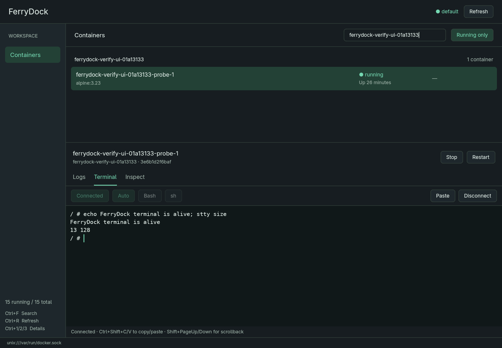

# FerryDock

A native desktop app for managing your Docker containers on Linux and macOS.

Find a container, follow its logs, open a shell, and start or stop it from one
window. FerryDock groups containers by Docker Compose project and keeps logs,
the terminal, and container details close at hand.



## What you can do

- **Find containers quickly.** Browse Compose projects and standalone containers,
  search by name, image, service, or project, and switch between running and all
  containers. A small colour marker beside each name matches its label in project logs.
- **Follow live logs.** Read output with ANSI colours and styles, pause automatic scrolling, copy
  logs, and reconnect the stream. Combine a Compose project's service logs in
  one view and filter them by service.
- **Monitor CPU and memory.** See live CPU percentage and memory usage/limit in
  the container list, with smooth area charts in the detail dock. Hover for
  measured values and sample age. Labelled axes show CPU percentage and memory
  in MiB, scaled to recent usage; available history spans the chart width, up
  to two minutes. The summary stays visible across Logs, Terminal, and Inspect.
  CPU 100% means one core; configured CPU quotas are shown separately. Containers
  without a memory limit show Docker capacity explicitly. Missing, stopped,
  disconnected, and stale readings are labelled instead of reported as zero.
- **Open a terminal inside a container.** Use Bash or sh with colors, scrollback,
  text selection, copy and paste, and support for full-screen terminal programs.
- **Start, stop, and restart containers.** See progress and any errors in the
  detail panel. Associate Compose files to control a whole project, rebuild its
  images and restart its services, and watch its operation output.
- **Inspect container configuration.** Read syntax-highlighted JSON with line
  numbers, text selection, folding, and built-in search. The view is read-only.
- **Manage local images.** Open **Images** to search tags, digests, or image IDs,
  read sizes and creation dates, and see every container using an image,
  including stopped containers. Ctrl-click to select several images, then review
    and remove them together with completion feedback, or prune untagged or all
    unused images.
- **Manage local volumes.** Open **Volumes** to search by name, driver, or Compose
  project, inspect configuration, and find running or stopped container references.
  Review permanent deletion before removing selected volumes, or prune unused
  anonymous volumes or all unused volumes.
- **Adjust the workspace.** Drag the divider between the container list and
  detail panel. Action buttons show loading state, and notifications report
  completed operations and copy feedback.
- **Choose your theme.** Open **Settings** from the sidebar or toolbar to choose
  **FerryDock**, **Dark**, or **Light**. The original charcoal and mint FerryDock
  theme remains the default. Changes apply immediately and are remembered on
  this computer; **Use FerryDock theme** restores the default.
- **Use resource menus.** Right-click a container or project, or use **More** in
  its detail toolbar, for navigation, configuration, and available actions.
- **Navigate container logs.** Use visible scrollbars for history and long
  lines. Opening a container shows the newest retained output immediately,
  then follows new lines without replaying the initial history.

## Get started

FerryDock is in early development. Packages target **Linux x86-64 with
Wayland or X11/XWayland** and **Apple Silicon Macs running macOS 15 or newer**,
with a **local Docker daemon**. macOS packages are previews pending native
desktop verification. You need a working graphics driver and access to Docker
from your user account. FerryDock uses your existing Docker installation.

### Install

Download a package from [GitHub Releases](https://github.com/pelletiermaxime/ferrydock/releases/latest).
macOS packages are included starting with `0.5.1`.

For **Apple Silicon macOS**, download `ferrydock-<version>-macos-arm64.dmg`,
open it, and drag **FerryDock.app** into **Applications**. Start Docker Desktop
or another Docker daemon using a local Unix socket context, then open FerryDock.
Docker Compose v2 is needed for project controls. Intel Mac packages are not provided.

Mac builds are **ad hoc signed and not notarized**. If macOS blocks the first
launch, try opening FerryDock, then go to **System Settings → Privacy & Security
→ Open Anyway** and confirm **Open**. See [Apple's instructions](https://support.apple.com/102445).

The **Linux x86-64** packages are built on Ubuntu 24.04 and require glibc 2.39
or newer.

The examples below use `0.9.0`; replace it with the version you downloaded.
On Ubuntu 24.04 or a compatible Debian-based distribution, install the Debian
package:

```sh
sudo apt install ./ferrydock_0.9.0_amd64.deb
```

Launch **FerryDock** from your applications menu or run `ferrydock` from a desktop
terminal. The package installs its runtime library dependencies automatically.
You still need Docker and a working graphics driver.

For a portable download on a compatible distribution, use
`ferrydock-0.9.0-linux-x86_64.AppImage`:

```sh
chmod +x ferrydock-0.9.0-linux-x86_64.AppImage
./ferrydock-0.9.0-linux-x86_64.AppImage
```

The AppImage bundles application libraries and needs no package installation.
It still requires glibc 2.39 or newer, an installed font, your desktop's
Wayland libraries and Vulkan/EGL graphics driver stack, and Docker. If FUSE
mounting is unavailable, run it with `--appimage-extract-and-run`.

Alternatively, extract
`ferrydock-0.9.0-linux-x86_64.tar.gz` and run `./ferrydock` from the extracted
directory. Its `INSTALL.txt` lists the runtime dependencies. Each release
includes a `SHA256SUMS` file to verify its downloads. On macOS, use
`shasum -a 256 <downloaded-file>` and compare the result with its entry in
`SHA256SUMS`.

To build from source instead, install Rust and the dependencies for
[Linux](docs/development.md#build-on-linux) or
[macOS](docs/development.md#build-on-macos), then run:

```sh
cargo build --release --locked
./target/release/ferrydock
```

On Linux, launch it from a terminal in your desktop session so it can use your
display and Docker environment.

### Your first container

1. Start Docker and launch FerryDock. The active Docker context appears in the
   window.
2. Find your container in its Compose project or the standalone group. Use the
   search field to narrow the list. Uncheck **Running only** to see
   stopped containers.
3. Select a container to open the detail panel. **Logs** shows its output;
   **Inspect** shows its configuration.
4. To run commands in a running container, choose **Terminal**, select **Auto**,
   **Bash**, or **sh**, and click **Open shell**. Auto uses Bash when available
   and falls back to sh.
5. Use **Start**, **Stop**, or **Restart** to control the selected container.
   Drag the divider above the detail panel to give logs or the terminal more
   space.

Type `exit` to end a shell normally. Stopping or restarting a container closes
its terminal session; open a new shell after it starts again.

### Manage a Compose project

Click a Compose project heading to open its controls in the bottom dock. Choose
**Associate files** to review the suggested project directory and Compose files.
Enter files in override order, one per line, and include the environment files
and profiles you normally use. Save the association to enable **Start**, **Stop**,
**Restart**, and **Rebuild & restart**. **Configuration** lets you edit it later.

The project's **Logs** tab combines output from all its containers, with a coloured
service/container prefix on each line that matches the container's list marker.
Use the searchable service picker to choose **All services** or
one service, pause/resume following, and copy the
filtered retained output. Logs work directly from Docker labels without a file
association. The view picks up restarted or recreated services automatically.
**Operations** keeps Start/Stop/Restart output separate from application logs.
Source colours stay stable during the session, including after filtering or
recreating a container with the same name, and adapt to light and dark themes.
The twelve-colour palette cycles for larger lists. Application ANSI styles remain
scoped to each container. Displayed and copied logs preserve application-written
dates and omit Docker's additional timestamp prefix. Copied project logs keep
their source labels without ANSI escape sequences.

Start creates or starts project services without building images. Stop and
Restart operate on the configured project's services. **Rebuild & restart**
builds images using Docker's build cache, then recreates and starts the configured
services, including services that use an existing image. Build and startup output
appears in **Operations**. If a build fails, its error and output remain available
and the running services are left in place. The dock streams Compose
output and keeps the latest result, including failures, when you switch away
and return. Project groups remain accessible when their containers are stopped.
Conflicting container and project operations are blocked.

Associations are saved per Docker endpoint and project name in
`$XDG_CONFIG_HOME/ferrydock/compose.json`, or `~/.config/ferrydock/compose.json`.
Only file paths and profiles are saved; environment-file contents are not
copied. Saved projects remain listed even if no containers remain. Docker Compose
v2 must be installed, and the associated files must be available on this machine.

## Keyboard shortcuts

These shortcuts work when the container list has focus. In search, press
**Escape** to return to the list; **Ctrl+A** selects the search text so typing
replaces it, or Backspace clears it.

Tab focuses controls; Enter or Space activates a focused button. In Inspect,
Ctrl+F searches the JSON, Enter moves to the next match, and Escape closes search.

| Shortcut | Action |
| --- | --- |
| Ctrl+F | Focus search |
| Ctrl+R | Refresh containers |
| Ctrl+, | Open or close appearance settings |
| Up / Down | Select a container |
| Enter | Open a shell in the selected running container |
| Ctrl+1 | Open Logs |
| Ctrl+2 | Open Terminal |
| Ctrl+3 | Open Inspect |
| Ctrl+4 | Open the selected container's Compose project logs |

Inside the terminal, control keys go to the shell. Drag to select text, then use
**Ctrl+Shift+C** to copy. Paste with **Ctrl+Shift+V** or **Shift+Insert**, and
scroll with the mouse wheel or **Shift+PageUp / Shift+PageDown**.

## Manage images

Choose **Images** in the sidebar. The list refreshes automatically while this
workspace is open; **Refresh** or **Ctrl+R** reloads it manually. **Ctrl+F**
focuses image search, and Up/Down selects an image when the list has focus.
Each image appears once, with all its local tags in the detail panel. Untagged
images remain visible. Click **Image / ID**, **Age**, **Size (MiB)**, or **References** to
sort that column; click again to reverse the order. An arrow marks the active
direction. Sorting stays active through search and refreshes, and preserves the
selected image. Unavailable sizes and creation dates stay last in either direction.
Sizes use MiB and include shared layers, so they do not
represent the space that removal would recover. **Age** shows time since image
creation, such as **2 hours ago**, rather than when it was pulled to this computer.
Ascending age sorts youngest first; descending sorts oldest first. The detail
panel retains the exact creation date and time in UTC.

The detail panel shows the full image ID and running or stopped container
references in **Overview**. **History** shows Docker's build commands, newest
first, in a compact table: #, Command, Size (MiB), Created (UTC), and Layer ID.
Drag header dividers to resize columns; use **Columns** to hide metadata fields.
Widths and column choices stay active while you browse images. Long commands
stay inside their cells. Double-click a row, press Enter on a selected row, or
choose **View command…** from its right-click menu to read, search and select
the full instruction. **Ctrl+F** searches the table's commands. **Ctrl+C** or
**Copy command** copies the selected instruction without metadata, and the
right-click menu can also copy its full layer ID. Home/End select the first/last
command. All metadata columns start visible. Missing values show **—**,
while metadata-only instructions can have a zero size.
**Inspect** shows read-only, syntax-highlighted image JSON with selection,
folding, and Ctrl+F search, just like container Inspect. Ctrl+1, Ctrl+2, and
Ctrl+3 switch between Overview, History, and Inspect in the Images workspace.
**Analysis** (Ctrl+4) exports the selected local image and shows each build
instruction, added/replaced/deleted file paths, the largest final files, and
estimated waste from payloads replaced or removed in later layers. Choose
**Analyze image** to start, **Cancel** to stop, or **Reanalyze** to read it again.
Layer sizes and file payloads use MiB; metadata-only instructions are labelled.
Waste excludes archive overhead and duplicate-content scanning, and does not
measure the Docker disk space that removing the image would recover. Empty
images show efficiency as unavailable. Large images can reach an explicit
analysis limit. Switching image tabs retains the report; selection, refresh,
workspace closure, or disconnect clears it.
**Refresh** retries detail reads. Click a referenced container to open its existing container view.
**Ctrl-click** adds or removes an image from the selection; a normal click
selects only that image. Selected IDs stay selected through sorting, searches,
and refreshes. The selected count also identifies images hidden by your search.

**Remove image…** or **Remove selected (N)…** opens a confirmation popup listing every selected
image, including hidden selections, with **Cancel** and **Remove N images** controls.
Removal is unavailable while discovery is unavailable, an image/Compose operation
is in progress, or all selected images are in use. FerryDock checks a fresh
inventory, then asks Docker to remove each selected image without force or
automatic deletion of parent images. Images used by running or stopped containers
are kept. A failure does not stop the rest of the batch; a notification reports
the completion counts and up to three failure examples. Cancel or Escape closes
the popup without removing anything.
Successfully removed images leave the selection; failures stay selected while
they remain in Docker. Docker conflicts, including images with multiple tags,
leave those images in place.

**Prune…** opens a dialog with **Cancel**, **All untagged images**, and **All unused
images**. The first removes unused images without tags (Docker's dangling-image
prune); the second also removes tagged images unused by any container. Images
referenced by running or stopped containers are kept. Pruning applies to the
connected Docker daemon's full inventory, regardless of search or selection.
Removed images may need to be pulled or rebuilt again. The button shows progress,
then a notification reports completion and reclaimed space in MiB when Docker
provides it. The inventory refreshes afterward. Cancel or Escape closes the dialog
without pruning; conflicting Docker operations disable the action.
Pulling, tagging, and registry browsing are not available in this Images workspace.

## Manage volumes

Choose **Volumes** in the sidebar. Search names, drivers, or Compose project
labels; click a volume or use Up/Down when the list has focus. The list refreshes
automatically while this workspace is open. **Refresh** or **Ctrl+R** reloads it,
and **Ctrl+F** focuses search. The **Age** column shows elapsed time since creation
using the same relative wording as Images, from minutes through years. Missing
or invalid creation dates show **Unavailable**; future dates are shown explicitly. Click **Volume**, **Driver**, **Age**, **Size**, or
**References** to sort; click again to reverse direction. Age sorts by the actual
creation instant, and unavailable ages stay last in either direction. Sorting,
selection, and search survive refreshes and workspace changes.

**Ctrl-click** adds or removes volumes from the selection; a normal click selects
one. Selected volumes stay selected through sorting, search, and refreshes. The
selected count identifies any selections hidden by search.

The detail panel shows the driver, scope, creation date in UTC, mountpoint on
the Docker host, labels, driver options, and running or stopped containers using
the volume. Click a referenced container to open its container view. Stopped
containers become visible automatically. A Docker Desktop mountpoint belongs to
its Docker host and may be inside its VM.

Click **Gather volume sizes** to ask Docker to calculate volume disk usage. The
**Size** column and detail panel show MiB; click its header to sort by bytes in
either direction. Unmeasured or unsupported volumes show **Unavailable** and
stay last in either direction. Gathering runs in the background with loading and
error feedback. The last measurement time is shown beside the button.
Measurements stay cached during automatic refreshes, **Refresh**, **Ctrl+R**,
workspace changes, and reconnecting to the same Docker endpoint. Only another
click recalculates them; a failed calculation keeps the previous values. The
cache lasts for the app session. Removed/recreated volumes and a different
Docker endpoint discard their old measurements. Gathering requires Docker 23+
(API 1.42+) and can take longer for volumes with many files.

**Remove volume…** or **Remove selected (N)…** opens a confirmation listing every
selected volume, including hidden selections and volumes in use. Removal is
available after successful discovery, with at least one unused selected volume
and no conflicting Docker operation running. The confirmation explains that
removal permanently deletes stored data. **Cancel** or Escape closes it without
deletion. FerryDock checks fresh running and stopped container references, then
asks Docker to remove each selected volume without force. Referenced volumes
are kept; a failure does not stop the rest of the batch. A notification reports
removed/failed counts and up to three failure examples. Successful volumes leave
the selection; failed volumes stay selected while they remain in Docker.

**Prune…** opens a confirmation with two choices: **Anonymous volumes only**
removes unused volumes created without an explicit name; **All unused volumes**
also includes unused named volumes. Both cover the connected Docker daemon,
regardless of search or selection, and keep volumes referenced by running or
stopped containers. Removed volumes and their stored data are permanently deleted.
Cancel/Escape leaves Docker unchanged. While pruning runs, conflicting mutations
are disabled. Completion reports removed volumes and reclaimed MiB, refreshes
references, and retains cached sizes for surviving volumes. These prune modes
require Docker 23+ (API 1.42+).

Creating volumes and editing their configuration are not available.

## Docker connections

FerryDock uses `DOCKER_CONTEXT` if set, then `DOCKER_HOST`, then your active Docker
CLI context. Local Unix socket connections are supported, including rootless
Docker and Docker Desktop contexts. The context and endpoint are displayed in the app.
On macOS, Finder launches also search `~/.docker/bin`, Homebrew's bin directories,
and Docker Desktop's app bundle for the CLI and its credential helpers. The
keyboard shortcuts use Control on both platforms.

To launch with a particular local context:

```sh
DOCKER_CONTEXT=my-local-context ferrydock
```

If the Docker CLI is unavailable, FerryDock tries a local Docker socket. If the
daemon disconnects, FerryDock retries the connection automatically.

## Troubleshooting

| Problem | What to check |
| --- | --- |
| FerryDock cannot connect to Docker | Make sure Docker is running and your account can access it. If you have the Docker CLI, run `docker ps` from the same terminal. |
| Your context is unsupported | Select a local Unix socket context. SSH, TCP/TLS, and Windows named pipe connections are not supported yet. |
| A stopped container is missing | Uncheck **Running only** and clear the search field. |
| A shell will not open | The container must be running and include Bash or sh. Minimal images may have neither. |
| FerryDock reports a missing display | Launch from your Linux desktop session with Wayland or X11/XWayland available. |

## Current limits

Individual container controls and Compose project Start/Stop/Restart and
Rebuild & restart are available. Images and Volumes have their own workspaces.
Down, network, and cleanup pages are planned.

Container logs and combined project logs each retain up to 1,500 lines; project
streams begin with the last 200 lines per container and merge output as received.
Initial container log history larger than 32 MiB is rejected with an explicit
error to keep oversized records from exhausting application memory.
Terminal scrollback retains up to 5,000 lines.
The terminal does not yet support input method composition (IME) or mouse input
for terminal applications. **Disconnect** detaches FerryDock from a shell;
use `exit` when you want to end the shell process.

FerryDock uses native Wayland when `WAYLAND_DISPLAY` is set, or X11/XWayland
when only `DISPLAY` is set. Apple Silicon macOS packages are previews pending
native desktop verification; Windows support is planned.

## Contributing

FerryDock is built with Rust and GPUI Kit. See the
[development guide](docs/development.md) for architecture, build instructions,
checks, verification coverage, and releases.

## License

FerryDock is available under the [MIT license](LICENSE).
